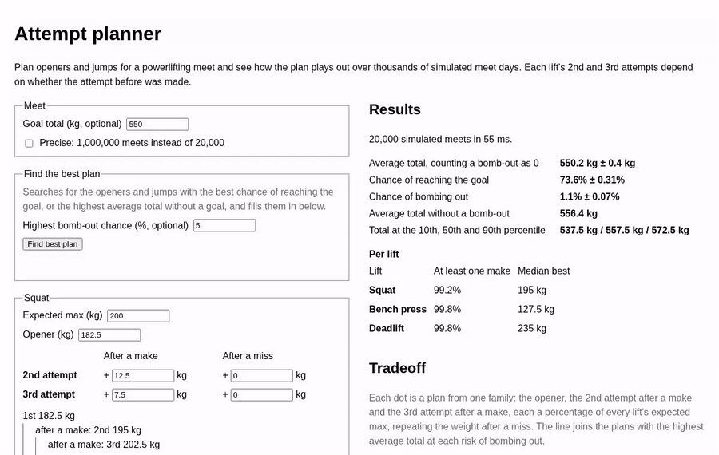

# attempt-planner

Choose openers and attempt jumps for a powerlifting meet by simulating the meet thousands of times. The simulator is Rust, compiled to WebAssembly, so everything runs in the browser.

**Try it: https://sebastianpantin.github.io/attempt-planner/**



## What it does

- **Estimate your maxes from past meets.** Paste the CSV from your OpenPowerlifting lifter page, or type each meet's date and nine attempts. The page estimates each lift's expected max today, how sure that estimate is, and how fast you have been getting stronger, and can fill them in. Nothing leaves the browser.
- **Plan in three steps.** Set the meet (goal total and the highest bomb-out risk you accept), enter each lift's expected max, and adjust the attempts the planner fills in: an opener, then how much to jump for the 2nd and 3rd attempts after a make and after a miss. Attempts follow the maxes as they change. First-timers get a short guide and a one-click safe plan, and short explanations sit next to the terms.
- **See how the plan plays out.** The typical total, the chance of reaching the goal and the chance of bombing out, from 20,000 simulated meets (or 1,000,000 in precise mode), with their Monte Carlo errors.
- **Analytics.** Where the total lands, the chance of reaching any total, which lift the bomb-out risk comes from, how each attempt goes, a bad, normal and good day, and the single changes of one or two plates that improve the plan most, each applied with one click.
- **Compare safer and bolder plans.** A chart of a whole family of plans, from conservative to aggressive, by bomb-out chance and average total, and a table of the best plan at each level of risk and for the goal. Any of them can be filled in with one click.
- **Find the best plan.** A search for the openers and jumps with the best chance of reaching the goal, or the highest average total without a goal, optionally keeping the bomb-out chance under a cap.

Plans follow the IPF attempt rules: at least the 20 kg bar, 2.5 kg steps, and every attempt after a made one must be heavier.

## The model

- **Day form.** Nobody hits exactly their expected max on the day. Each simulated meet draws a day max for every lift: the expected max times 1 plus a normal draw. Its spread combines two things: how much strength moves from day to day (3% by default) and how far off the expected max itself may be (3% by default; lower it when the max comes from a recent test or meet). The three lifts share part of that draw (correlation 0.4 by default), because a good day for the squat tends to be a good day for the deadlift.
- **Two kinds of miss.** A strength miss happens when the load is too heavy for the day: the chance of making an attempt falls along a logistic curve as the load nears and passes the day max, set by the load ÷ day max ratio with a 50% make rate and how steeply the chance falls around it. A technical miss, like a depth call or a missed command, is a fixed chance per attempt whatever the load. Results show each lift's share of attempts missed each way. Attempts are independent once the day max is drawn; there is no fatigue.
- **Plans.** The 2nd and 3rd attempts react to the attempt before: a jump after a make and a jump after a miss (0 repeats the weight). Missing all three attempts of a lift is a bomb-out, counted as a total of 0.
- **Same days for every plan.** Every plan is scored against the same seeded simulated days, so differences between plans are not luck of the draw. Each roll becomes the weight in plate steps from which that attempt is missed, stored in one array per lift and attempt, so scoring a plan is a pass of whole-number comparisons over arrays that runs on several days at once (SIMD). The days are simulated once per lifter and reused while only the plans change.
- **Search.** Starts from the best plan in the tradeoff family, then changes one setting of one lift at a time and keeps any change that ranks higher, until a whole round changes nothing. It picks and reports plans on the same 20,000 meets, so its figures are slightly optimistic; precise mode re-checks a plan on more meets.

The day form and make-rate numbers are inputs under "Advanced".

### Estimating maxes from past meets

A meet's attempts say a lot about the day max: it was above every made attempt and probably below the misses. The estimate takes each lift's level today and one yearly rate of progress shared by the lifts, and picks the values that make the past meets' makes and misses most likely under the make-rate curves and day form above. Two more pieces of evidence keep it sensible when there is little data:

- Lifters open at a typical share of their max (the fitted 89–91%, give or take 5%), so a lifter who never misses still gets a finite max.
- Progress is assumed to be none, give or take 10% a year, until the meets say otherwise.

The uncertainty it reports comes from how sharply the likelihood peaks, and is filled in as the uncertainty of the expected max. It assumes steady progress, so a long history with a recent jump or slump can make it too sure; leaving out old meets helps.

### Where the default make-rate curve comes from

[OpenPowerlifting](https://www.openpowerlifting.org) records every attempt and whether it was made, but not anyone's max on the day, so the curve can't be read off the data directly. Instead it is calibrated to how often lifters make each attempt:

- From about 490,000 raw full-power IPF meets per lift (the planner follows IPF rules), measure how often the 1st, 2nd and 3rd attempts are made, and the median jump after a make and after a miss.
- Call the expected max the weight a lifter makes half the time on a normal day, apart from technical misses, so the curve's midpoint is 1.
- Fit each lift's steepness, technical-miss chance and typical opener, with one spread of the day max shared by all lifts, so that a lifter following the typical jumps makes the opener, and the 2nd and 3rd attempts after a make and after a miss, as often as the data says.

How often a repeated weight is made after a miss tells the two kinds of miss apart. After a technical miss the repeat is usually made; after a strength miss on a bad day it usually is not. In the data, repeats after a miss are made only 42–59% of the time, so most misses behave like strength misses.

| Lift | Made: 1st, 2nd after make / miss, 3rd after make / miss | Predicted | Steepness | Technical miss | Typical opener |
| --- | --- | --- | --- | --- | --- |
| Squat | 89, 86 / 73, 68 / 55% | 98, 86 / 75, 66 / 54% | 56 | 0% | 89% |
| Bench | 92, 82 / 73, 51 / 37% | 95, 76 / 73, 56 / 37% | 94 | 3.0% | 91% |
| Deadlift | 96, 89 / 78, 64 / 37% | 98, 88 / 78, 65 / 37% | 109 | 0.9% | 89% |

The fitted spread of the day max is 4.3%. It counts both how much a lifter's strength moves from day to day and how far off their expected max is. Lifters who competed more than once split the two apart: across about 79,000 pairs of meets by the same lifter 28 to 120 days apart, each lift's best moves by a robust 2.8–3.2% per meet, so about 3% is day form and the remaining 3% is uncertainty in the expected max. These are the planner's defaults. The same pairs give the correlation between lifts: a change in the squat goes with a change in the bench (0.37) and the deadlift (0.47), and bench with deadlift 0.34, averaging 0.4. The 3% day form is in line with how much elite weightlifters vary from one competition to the next, 2.3–2.7% ([McGuigan & Kane 2004](https://pubmed.ncbi.nlm.nih.gov/15320651/)).

Men and women differ enough to fit separately, and the page's "Lifter" choice switches between the fits:

| | Steepness (squat / bench / deadlift) | Technical miss (bench / deadlift) | Day form | Max uncertainty | Correlation |
| --- | --- | --- | --- | --- | --- |
| Men | 58 / 99 / 116 | 3.1 / 1.1% | 2.9% | 3.0% | 0.42 |
| Women | 51 / 77 / 93 | 1.8 / 0.8% | 3.2% | 3.4% | 0.36 |

Women's make rate falls less steeply past the day max, especially on the bench, and their results vary more from meet to meet, as in other strength sports ([McGuigan & Kane 2004](https://pubmed.ncbi.nlm.nih.gov/15320651/)).

The fit still makes squat openers look safer than they are, and fitting IPF meets alone does not change that, so it is not down to judging in some federations. With one spread for all lifts, the model can't produce the 12% of missed squat openers while also keeping repeats after a miss as hard as they are. Missed depth may well be part of that: it tends to repeat, so it behaves more like a strength miss than a technical one. Lifters also pick their jumps knowing how the day is going, which the typical plan ignores.

`crates/fit` does the calibration. Download the bulk CSV from https://data.openpowerlifting.org, unzip it, and run:

```sh
cargo run --release -p attempt-fit -- --federation IPF path/to/openpowerlifting.csv
cargo run --release -p attempt-fit -- --federation IPF --sex F path/to/openpowerlifting.csv
```

It takes a few seconds. This uses data from the OpenPowerlifting project, https://www.openpowerlifting.org, which is in the public domain; this repository does not include it.

### Backtest

`--backtest` checks the model on meets it has not seen. It fits to nine lifters in ten. For each other lifter with two or more complete meets, it estimates the expected maxes for their latest meet from up to six meets before it, as the page does from past meets. It then gives each attempt of that meet a chance of being made, given the attempts before it, and scores the chances:

```sh
cargo run --release -p attempt-fit -- --federation IPF --backtest path/to/openpowerlifting.csv
```

It takes about two minutes. Lower log loss is better. On IPF meets up to October 2026 (9,044 lifters, 81,396 attempts, 78% made):

| Chance of each attempt from | Mean predicted | Log loss |
| --- | --- | --- |
| The share of that attempt made, after a make or a miss, whatever the load | 78% | 0.447 |
| The model, with maxes from past meets | 69% | 0.700 |
| The model, with maxes from past meets and the opener the lifter chose | 73% | 0.577 |
| As above, with a share of lifters prone to misses whatever the load | 73% | 0.565 |
| As above, each lifter's share updated by their past misses | 73% | 0.564 |
| The model, with the opener, and the 2nd and 3rd attempts the lifter chose | 78% | 0.497 |
| As above, with a share of prone lifters | 78% | 0.498 |

With maxes from past meets, even with the opener, the model is too pessimistic: attempts it gives under 50% are made 58–63% of the time. The largest gap is a repeat after a miss: the model reads a missed attempt as a bad day and gives the repeat 49–61%, but lifters make it 73–76% of the time.

Misses do run in lifters. A lifter who missed their opener misses the next meet's opener more often: 13.7% against 8.7% on the squat, 9.2% against 5.9% on the bench and 7.7% against 3.9% on the deadlift. Fitting a share of lifters prone to misses whatever the load to that fixes the squat opener (90.6% predicted against 88.9% made, from 98%), but it gains little in the backtest. The fit puts every repeated miss down to being prone, though other habits repeat too, such as always opening heavy, so it likely overstates the share.

Most of the gap is that lifters choose their 2nd and 3rd attempts knowing how the day is going. Taking each chosen attempt as evidence of the day max, as a typical share of it give or take a spread fitted to the other lifters, brings the predictions in line with what lifters make. Lifters take their 2nd attempt at about 97% of that day's max and their 3rd at 97% after a make and 102% after a miss, give or take only 2%. With that, a share of miss-prone lifters no longer helps. What is left is overconfidence at both ends: attempts given 98% or more are made 95% of the time.

So the curve and day form hold up for a plan made before the meet. The lesson for the meet itself is that how an attempt moves says a lot about the day.

The engine takes plain data in and out, with no browser code, so other front ends can reuse it.

## Layout

- `crates/sim`: the simulator: rules, model, evaluation, the tradeoff sweep and the search. Plain Rust with no WebAssembly dependencies.
- `crates/sim-wasm`: `wasm-bindgen` bindings for the browser
- `crates/fit`: calibrates the default make-rate curve to OpenPowerlifting results and backtests it
- `web`: the page served on GitHub Pages, built with Vite and TypeScript. The simulation runs in a Web Worker so the page stays responsive.

## Development

### With Docker only

No Rust toolchain needed.

```sh
docker build -t attempt-planner . && docker run --rm -p 8000:80 attempt-planner
```

Then open http://localhost:8000. Run the checks with:

```sh
docker build --target test .   # Rust: fmt, clippy, tests, WebAssembly tests in Node
docker build --target web .    # page: format, type-check, tests, build
```

### With Rust installed

```sh
cargo test --workspace
cargo run --release -p attempt-sim --example timings   # how long each engine call takes
```

To work on the page, build the WebAssembly package into `web/pkg`, then start the Vite dev server. This needs Node 24, the `wasm32-unknown-unknown` target and [wasm-pack](https://github.com/drager/wasm-pack):

```sh
wasm-pack build crates/sim-wasm --target web --out-dir ../../web/pkg
cd web
npm install
npm run dev
```

`docker build --target pkg --output web/pkg .` builds the same package if you have Rust but not the wasm tools. In `web`, `npm run check` checks formatting and types, `npm run format` formats, and `npm test` runs the tests.

## License

MIT. See [LICENSE](LICENSE).
